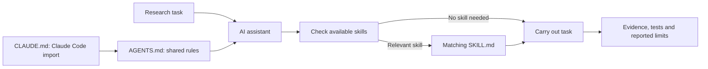

# Research AI Toolkit

*Reusable AI skills and guidelines for scientific research.*

[](https://github.com/mug-n-ai/research-ai-toolkit/releases/latest)
[](https://github.com/mug-n-ai/research-ai-toolkit/actions/workflows/check.yml)
[](skills/README.md)
[](LICENSE)
[](CONTRIBUTING.md)

**Works with:** [](INSTALL.md#claude-code-from-the-clone) [](INSTALL.md#codex-from-the-clone) [](INSTALL.md#opencode-from-the-clone) [](#use-the-toolkit-in-a-chat) and other chat interfaces that can read public links.

Use this toolkit when you want an AI assistant to help with your own research, from checking the evidence behind a draft to rerunning an analysis.

**Core principles:** Verify sources · Reproduce results · Reuse workflows

**You do not need to choose a skill yourself.** Once the toolkit is installed in a client that can discover its skills, just describe what you want to do. The assistant can match your request to an available skill and follow its instructions when relevant. For example, asking “Does this paragraph agree with the published evidence?” can bring in `literature-review` automatically. You do not need to say “use literature-review” or know the names of the skills.

Some workflows are marked **By request** and need to be invoked explicitly. In a web chat without installed skills, start with the [chat prompt](#use-the-toolkit-in-a-chat) so the assistant knows where to find the catalogue. Automatic selection also depends on the client and which skills it can access.

## Contents

- [Quick start](#quick-start) · [Use the toolkit](#use-the-toolkit) · [Research workflows](#research-workflows)
- [Project rules and knowledge bases](#project-rules-and-knowledge-bases) · [What is a skill?](#what-is-a-skill)
- [Optional tools](#optional-tools) · [Contributing](#contributing) · [Licence](#licence) · [How this repository was made](#how-this-repository-was-made)

## Quick start

[Use the chat prompt](#use-the-toolkit-in-a-chat) or [start with the recommended selection](INSTALL.md#recommended-installation), then give the assistant a task and the material it needs. Here are four requests to adapt.

> [!TIP]
> **You can ask an AI assistant to install the toolkit.** Give Claude Code, Codex or OpenCode the [setup prompt](INSTALL.md#ask-an-assistant-to-set-it-up). It should check your existing configuration, preserve your settings and verify the installation.

- “Check which papers support each claim in this paragraph. Read the full sources and inspect their original figures. Point me to the relevant passages and flag any claim you could not verify.” [Literature review](skills/literature-review/SKILL.md)
- “Reproduce this figure using the data and code revision I supplied. Record the settings and seeds, save the new plot separately and report what differs.” [Reproduce analysis](skills/reproduce-analysis/SKILL.md)
- “Check the units in this calculation and propagate the reported uncertainties. Tell me what correlation information you need and state what the final interval represents.” [Uncertainty and units](skills/uncertainty-and-units/SKILL.md)
- “Audit this repository for dead code, unnecessary complexity and duplication. Follow the existing design decisions and give me a prioritised plan without changing files.” [Code cleanup](skills/code-cleanup/SKILL.md)

## Use the toolkit

### Choose your tool

| Tool | How to use the toolkit |
| --- | --- |
| Chat interfaces | Use the prompt below in any chat that can open public links, or share the files directly. |
| Codex | Use one local clone across your projects, or install the rules and skills in a single project. [Codex setup](INSTALL.md#codex-from-the-clone) |
| Claude Code | Use one local clone for all your projects, or copy the files into a single project. [Claude Code setup](INSTALL.md#claude-code-from-the-clone) |
| OpenCode | Point OpenCode at the same clone, or copy the files into a single project. [OpenCode setup](INSTALL.md#opencode-from-the-clone) |

### Install it with an assistant

An assistant with terminal access on the machine where you run Codex, Claude Code or OpenCode can install the toolkit for you. Tell it which tools and scope you want. It can check your existing setup, choose how to make the rules and skills available, and verify the result. [Copy the setup prompt](INSTALL.md#ask-an-assistant-to-set-it-up)

### Use the toolkit in a chat

Paste this prompt into ChatGPT, Claude, or any other assistant that can open public links. Replace the last line with your task so the assistant can open the rules and workflow it needs.

<details>
<summary>Show the prompt for a web chat</summary>

```text
Use the Research AI Toolkit. Base URL for the paths below:
https://raw.githubusercontent.com/mug-n-ai/research-ai-toolkit/main/

Read rules/research-practice.md for research. For code changes, read
rules/code-planning.md and rules/testing.md. Open other rule modules as needed.

Open skills/<name>/SKILL.md and any references needed. Match the task:
papers → literature-review, reruns → reproduce-analysis, new runs → run-provenance,
test-first coding → tdd. For other workflows, consult skills/README.md. Use
"By request" skills only if I name them. Report any blocked step.

My task: [describe what you want to do]
```

</details>

If the assistant cannot open the links, paste or attach the relevant [rule modules](rules), `SKILL.md` and supporting files. For a project that already uses the toolkit, share its own instructions for project-specific details.

## Research workflows

The workflows below show what the toolkit can help with, not commands you have to memorise. When a matching skill is available, the assistant can choose it from the task you describe. The links let you inspect the instructions and examples.

### Literature review

The `literature-review` skill can find papers, check a claim or continue a reading list. Read each source used as evidence in full and inspect its figures in the original paper. Record which passage supports the claim and the conditions that limit what you can conclude. [Skill instructions](skills/literature-review/SKILL.md) · [Example: sodium in HD 209458 b](examples/literature-review/README.md)

### Reproduce an analysis

The `reproduce-analysis` skill traces a figure, table or number to its inputs, code and run settings. Rerun it in a separate output directory and record what matches, what differs and what you could not check. [Skill instructions](skills/reproduce-analysis/SKILL.md) · [Example: Anscombe's quartet](examples/reproduce-analysis/README.md)

### Record computational runs

The `run-provenance` skill records what each computational run needs before it starts, whether it is a simulation, a model training, a data-processing pipeline or a batch analysis: the code revision, the copied configuration, input checksums, the environment and the seeds. Each run gets its own directory, and figures and numbers name the runs they came from. [Skill instructions](skills/run-provenance/SKILL.md) · [Run record](skills/run-provenance/run-record.md)

### Document an investigation in LaTeX

The [`research-report` skill](skills/research-report/SKILL.md) helps document physical models, methods, analyses, code and verified results as a technical research note. It is **not** a journal paper drafting tool: the researcher remains responsible for scientific decisions and conclusions. The skill uses equations, provenance and explanatory diagrams when useful, while respecting external author voice preferences. Its default `scrartcl` template and [small standard-library helper](skills/research-report/scripts/report_project.py) create a portable `overleaf/` source folder and `report-overleaf.zip` with `main.tex` at the archive root. Local PDF compilation is optional and requires a TeX installation; the ZIP can be prepared without one.

### Clean up code

The `code-cleanup` skill can find dead code, remove unnecessary complexity, reduce duplication or check whether an implementation still follows the project's design. **For a single function**, it makes a targeted refactor and tests the behaviour. **For a whole repository**, it identifies candidates and writes a prioritised plan without changing the implementation. Static-analysis findings are leads, not proof that code is safe to remove. [Skill instructions](skills/code-cleanup/SKILL.md) · [Cleanup plan template](skills/code-cleanup/cleanup-plan-template.md)

### Third-party skills for research work

Use No AI Slop to review a draft, Matt Pocock's skills to plan and test software, or K-Dense's workflows to inspect data, check units and prepare figures. The [skill catalogue](skills/README.md) explains when to use each one and lists its source, licence and companions.

## Project rules and knowledge bases

### What the files do

| File | When to use it |
| --- | --- |
| [`rules/`](rules) | The shared rules, one module per topic: [research practice](rules/research-practice.md), [planning code changes](rules/code-planning.md), [Git workflow and versioning](rules/git-workflow.md), [attribution](rules/attribution.md), [testing](rules/testing.md) and [code documentation](rules/code-documentation.md). Import only the modules you want if you do not need them all in every session. |
| [`AGENTS.md`](AGENTS.md) | All the rule modules in one file, for a personal installation across your projects. Codex and OpenCode read it directly. It is generated from `rules/`. |
| [`CLAUDE.md`](CLAUDE.md) | Claude Code's entry point. It imports the neighbouring `AGENTS.md` with `@AGENTS.md`. |
| [`templates/AGENTS.md`](templates/AGENTS.md) | Starter instructions for one project: the same rules with empty sections for the project's context and workflow. Copy it into the project with `CLAUDE.md`, and put Claude-specific instructions below the import. |

### Rules for research software

| Rule | What to do |
| --- | --- |
| [Research scope and writing style](AGENTS.md#research-practice) | Assist research and document evidence; never invent findings or draft research papers. Follow author/project writing preferences and external voice skills ahead of generic toolkit style suggestions. |
| [Supervisor-ready work](AGENTS.md#research-practice) | Check the approach, assumptions and results critically before handing work over, then give a concise, evidence-linked summary that the researcher can inspect and challenge. |
| [Before changing code](AGENTS.md#before-changing-code) | Inspect and plan meaningful changes before editing. For bugs and conflicts, trace the cause and select the simplest correct fix consistent with the project's architecture and scientific assumptions, rather than a shortcut. Quick changes can skip the planning update, not the diagnosis or quality checks. |
| [Branches and pull requests](AGENTS.md#git-branches-and-pull-requests) | Work on a separate branch. With `develop`, open a PR into it and a separate PR when promoting the changes to `main`. In a `main`-only project, open the PR there. Get explicit approval for any direct commit or push to either branch and for each merge. |
| [Branch cleanup](AGENTS.md#git-branches-and-pull-requests) | Delete the temporary working branch after merge, unless the user asks to keep it or another open PR depends on it. |
| [End-of-task cleanup](AGENTS.md#end-of-task-cleanup) | Remove task-specific disposable files and temporary Git worktrees or merged branches once safe; preserve research data, uncommitted work and anything uncertain. Check and report the workspace state before finishing. |
| [Versioning](AGENTS.md#versioning-on-main) | Before each update to `main`, recommend no bump, a patch, a minor or a major release and give the reason. Follow the project's release policy and flag any effect on compatibility or existing scientific results. |
| [Tests for every new function](AGENTS.md#tests-for-every-new-function) | Add a behaviour-based test when creating a function or method. For new behaviour or a bug fix, write the test first when practical. Check that it fails for the expected reason and passes after the change. Report what you ran and what happened. |
| [Fast, reliable tests](AGENTS.md#tests-for-every-new-function) | Use the smallest deterministic test that reliably checks the behaviour. Keep expensive validation separate from routine PR CI where practical, without sacrificing coverage or scientific correctness. |
| [Docstrings](AGENTS.md#code-documentation-and-physics) | When adding or changing code, document its use cases, an example, the inputs and outputs, and the errors callers may encounter. |
| [Physics in code](AGENTS.md#code-documentation-and-physics) | Explain the model, equations, units, assumptions and limits in the docstring. Use comments beside the calculations to explain the physical reasoning. |
| [Signatures and attribution](AGENTS.md#attribution-and-signatures) | Use the user's authorised identity for commits and signatures. Keep any AI-use disclosure required by the project or publisher. |

Even a short script or a function written directly in chat needs a test. You do not need to introduce an entire testing framework for a one-off function, but you should still check a normal case and meaningful edge cases, and distinguish a test you ran from one you only supplied.

### Keep a local knowledge base

> [!IMPORTANT]
> **Keep scientific work traceable.** Check AI-generated claims and citations against the original sources, and verify calculations and numerical results before relying on them. Use only approved tools and environments for unpublished manuscripts and restricted research data.

Keep checked papers, code revisions and methods notes where the assistant can read them. Record the DOI or original link for each paper and ask the assistant to cite the passage behind each substantive claim. Before sharing unpublished work or restricted data, check which tools and providers can access it. [Research practice](AGENTS.md#research-practice)

[Carsen](https://github.com/LorenzoMugnai/Carsen) is one example. It indexes local files and returns passages with their file paths and line ranges through MCP. You can ask an assistant with terminal access to install it, configure it to index your folders and test a search. [Carsen setup guide for AI agents](https://github.com/LorenzoMugnai/Carsen/blob/main/docs/agent-setup.md)

## What is a skill?

A skill is a folder of instructions for a task you expect to repeat. Its `SKILL.md` tells the assistant when to use it and what steps to follow. Keep any scripts, references or templates the workflow needs in the same folder.

### How the assistant chooses a skill

In clients that support skill discovery, the assistant reads the descriptions of available skills and chooses a relevant workflow for the task. You can also name a skill if you want a specific one. Skills marked **By request** are deliberately not selected automatically: ask for them by name. If a skill is missing, check its installation and the client's settings. Without installed skills, the [chat prompt](#use-the-toolkit-in-a-chat) tells the assistant where to find the public catalogue.

To create your own skill, follow the [instructions in CONTRIBUTING.md](CONTRIBUTING.md#create-a-skill). They include an example `SKILL.md` and a prompt you can give an assistant.

### How the pieces fit together

The shared rules give the assistant guidance across research tasks. You can use the combined `AGENTS.md` or select individual modules. Claude Code can import either through `CLAUDE.md`. The assistant opens a matching `SKILL.md` when it needs one. The web chat prompt points it to individual modules and the relevant workflow.



Which skills and checks can actually run depends on the client and its available tools. The [installation guide](INSTALL.md) explains how each client finds the rules and skills.

## Optional tools

### arXiv MCP server

For arXiv literature work, the optional [arxiv-mcp-server](https://github.com/blazickjp/arxiv-mcp-server) provides paper searches, bounded text reads, source LaTeX and citation utilities. It is **not** installed by this toolkit and is not required by `literature-review`. If you already have a working arXiv MCP connection, keep it rather than adding a duplicate. See the [optional MCP setup and verification guide](INSTALL.md#optional-arxiv-mcp-server) for Claude Code, Codex and OpenCode. Paper text retrieved through MCP still needs source, version and figure checks.

### AI footprint hook

Claude Code and Codex can show the estimated electricity, water and CO₂e for each reply. The hook uses local token counts and is off by default. Once you have installed it, start the client with `RESEARCH_AI_FOOTPRINT=1 claude` or `RESEARCH_AI_FOOTPRINT=1 codex`. The figures depend on the infrastructure scenario you choose. [AI Footprint setup and methodology](integrations/ai-footprint/README.md)

**If you find this toolkit useful, consider starring the repository.** It helps other researchers find it.

## Contributing

See the [contribution guide](CONTRIBUTING.md) to propose a rule, add a skill or improve the documentation.

See the [changelog](CHANGELOG.md) for changes or [choose a version](INSTALL.md#choose-a-version) for your installation.

## Licence

The original material in this toolkit is available under the [MIT Licence](LICENSE). This includes the project templates, shared rules, documentation and the `literature-review` skill. Imported skills carry their own licence and copyright notices. [Third-party sources and licences](skills/README.md#sources-and-licences)

## How this repository was made

This entire repository was put together using ChatGPT through its web chat, including the documentation, project templates and integration of the third-party skills. The [skill catalogue](skills/README.md#sources-and-licences) credits the original authors and links to their licences.
