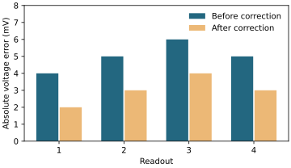

# Bench note on a detector offset correction

Fictional source for the literature-review example. This note and its figure contain simulated measurements.

## Introduction

We tested whether applying a fixed offset correction reduced absolute error in the measured voltage of one detector. This check used a single operating temperature.

## Methods

The detector was held at 20 °C. We collected four readouts of the same fixed reference voltage and subtracted 2 mV from each as a correction. The uncorrected readouts were all above the reference. We calculated their absolute errors before and after the correction and averaged them over the four readouts.

## Results

| Readout | Before correction (mV) | After correction (mV) |
| --- | ---: | ---: |
| 1 | 4 | 2 |
| 2 | 5 | 3 |
| 3 | 6 | 4 |
| 4 | 5 | 3 |
| Mean | 5.0 | 3.0 |

**Figure 1.** Absolute voltage error for each paired readout at 20 °C. The bars show individual errors in mV.

## Discussion

Across the four readouts, the mean absolute error fell by 2.0 mV, or 40% of the uncorrected mean. The comparison used one detector at 20 °C. We did not measure other temperatures or estimate the uncertainty of the reduction.
