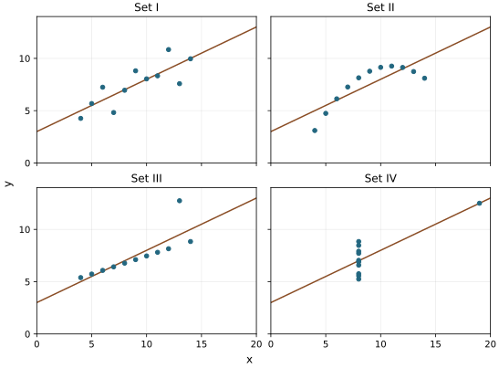

# Reproduce Anscombe's quartet

In *Graphs in Statistical Analysis* (1973), Francis Anscombe constructed four datasets whose linear fits give nearly the same numerical summaries. The plots show why you would interpret the four fits differently. This example uses the [reproduce-analysis skill](../../skills/reproduce-analysis/SKILL.md) to check both parts of the result. [Published paper](https://doi.org/10.1080/00031305.1973.10478966) · [Scanned paper, §3 and Figures 1–4](https://garstats.wordpress.com/wp-content/uploads/2016/08/anscombe-as-1973.pdf#page=4)

## Input

Use the [transcribed data](anscombe.csv) from the table on p. 19 and the [plotting script](plot.py). The column `x123` supplies the common predictor values for the first three datasets. The fourth dataset uses `x4`. Each has 11 observations.

> Reproduce Figures 1–4 and the reported intercept, slope and R² from §3. Fit each dataset separately by ordinary least squares with an intercept. Preserve the input and save the new results in a separate directory. Compare the plotted points and lines to the original figures on common scales. Compare the intercept with 3 using an absolute tolerance of 0.005, and the slope and R² with 0.5 and 0.667 using an absolute tolerance of 0.001 each. Check what happens to the slope of set IV when you remove the point at x = 19.

## Run it

From this directory, in a Python 3.12 environment, run:

```sh
python -m pip install matplotlib==3.10.8
python plot.py --output rerun
```

The command writes `rerun/figure.svg` and `rerun/fits.csv`. Choose a fresh output directory for each run. The comparison below used Python 3.12.14 and Matplotlib 3.10.8. [Saved fit results](reference/fits.csv)

## Example output

**Result.** The coefficients and R² agree with the published summary within the stated tolerances. Sets II and III round to 0.666 for R² at three decimal places. The values are close enough for the published comparison and still show small differences when reported at greater precision.

| Dataset | Intercept | Slope | R² |
| --- | ---: | ---: | ---: |
| I | 3.000091 | 0.500091 | 0.666542 |
| II | 3.000909 | 0.500000 | 0.666242 |
| III | 3.002455 | 0.499727 | 0.666324 |
| IV | 3.001727 | 0.499909 | 0.666707 |



The four panels reproduce the patterns in the paper. Set I is reasonably described by a line. Set II curves. In set III, one point pulls the fitted line away from the pattern in the other points. In set IV, removing the point at x = 19 leaves all ten predictor values at x = 8. With no variation in x, the slope is undefined. The figure above is a new rendering from the published data.
